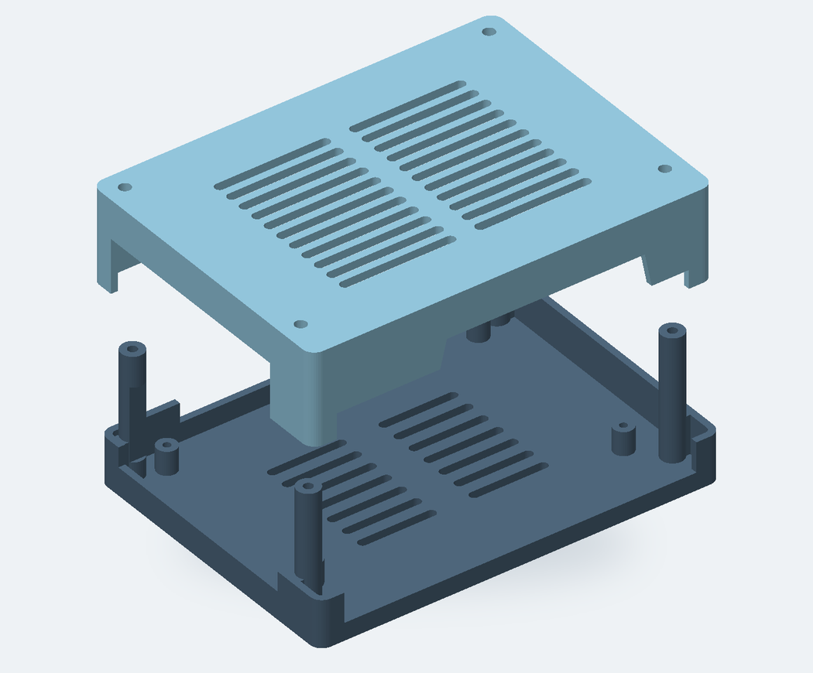
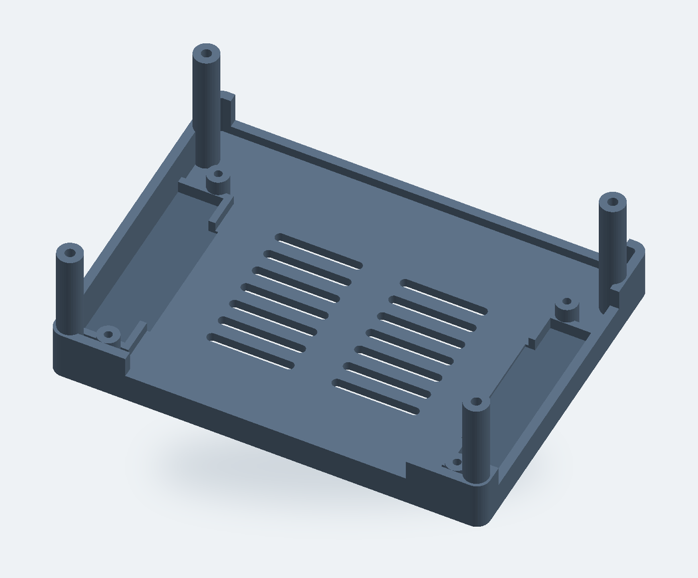
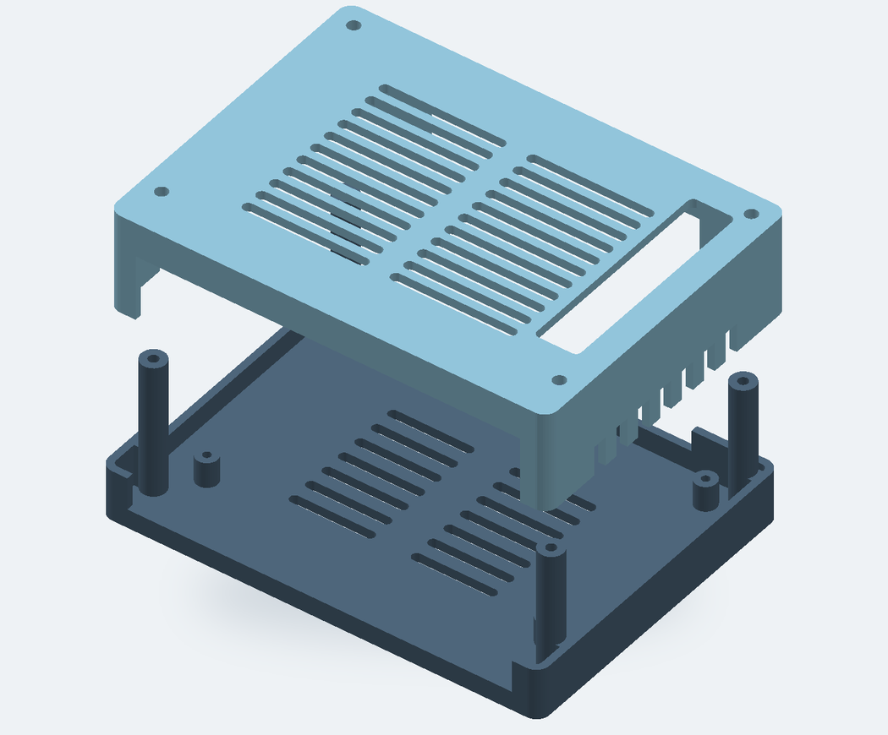
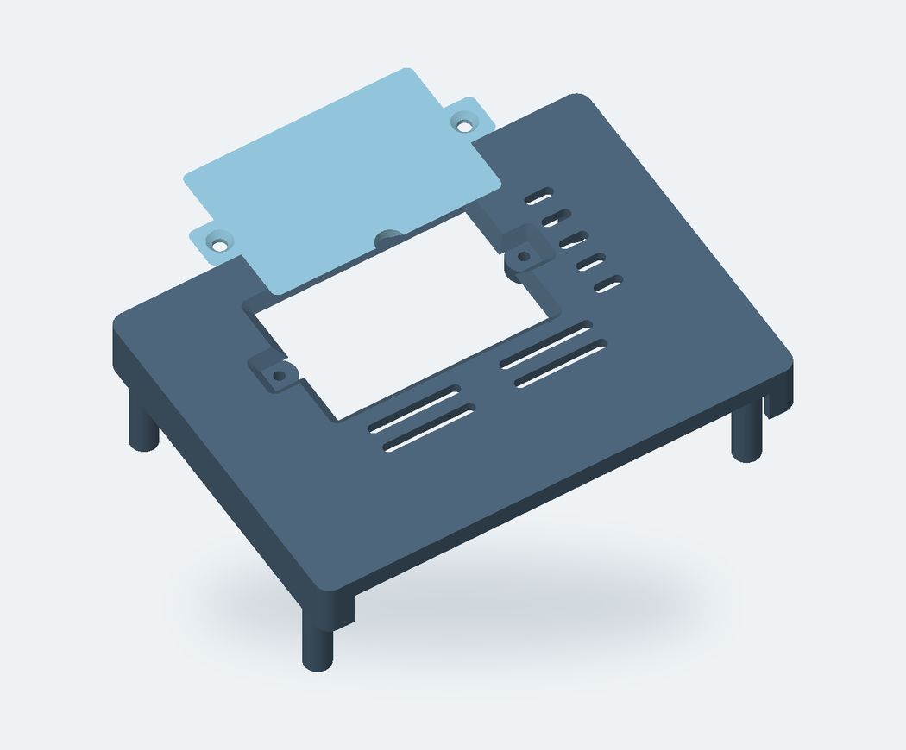

# Synaptics Astra SL16x0 / SL21x0 casing

A 3D printable enclosure for the complete Synaptics Astra Machina development kit, including the I/O carrier and its installed compute module. Choose the standard base, the base with antenna pockets, or the base with antenna pockets and a removable Wi-Fi hatch. Either lid fits all three bases.

## Compatibility

The enclosure is dimensioned around the shared **100 × 79 mm SL16X0 I/O carrier** with a **92 × 58 mm** mounting pattern. This carrier is used by Astra Machina SL16x0 kits (SL1620, SL1640, and SL1680) and by the SL2610 kit in the SL2600 series. The [SL16x0 hardware guides](https://synaptics-astra.github.io/doc/v/latest/hw/) and the [SL2600 series developer kit guide](https://cp.synaptics.com/cognidox/download/NR-160458-MS-APPROVED.pdf#page=6) show the shared carrier.

The mounting hole pattern was checked on an SL1680 kit with the supplied template. For another carrier revision or compute module, check the template, port access, and clearance for the installed heatsink or add-on cards before printing the enclosure.

| Dimension | Size |
| --- | --- |
| Assembled enclosure | 119.2 × 88 × 41.4 mm |
| Side walls / lid top | 2.0 mm / 2.4 mm |
| Base floor / floor under antenna pockets | 2.6 mm / 2.0 mm |
| Clearance from the top of the I/O board to the underside of the lid | 27.8 mm |
| Each internal antenna pocket | 52 × 12 × 3.5 mm |
| GPIO lid opening | 63.8 × 12 mm |
| Rear microSD opening | 74 × 16.8 mm |

## Print files

| File | Use |
| --- | --- |
| [Mounting template](Lochschablone.stl) | Check the four carrier board mounting holes before printing the enclosure. |
| [Standard base](Boden.stl) | Ventilated base with mounting posts for the carrier board and lid. |
| [Base with internal antenna pockets](Boden-Antennen-Innen.stl) | Two rectangular pockets alongside the floor vents with open channels for the coax cables. |
| [Base with Wi-Fi access](Boden-WLAN.stl) | Internal antenna pockets and access to the M.2 card from below. |
| [Wi-Fi hatch](WLAN-Klappe.stl) | Matching removable cover for the access base. |
| [Standard lid](Deckel.stl) | Ventilated lid with four mounting holes. |
| [Lid with GPIO access](Deckel-GPIO-12mm.stl) | Same mounting pattern with an opening over the 40-pin GPIO header (J32). |

Print the template first. Then print one base and one lid in the supplied STL orientation. For the Wi-Fi access base, also print the matching hatch. **PETG, 0.2 mm layers, and three wall loops** are a starting point. Check the short bridges at the two hatch screw mounts in your slicer. The lid's outer face sits on the build plate. Turn the lid over for assembly with the wide I/O edge facing the carrier's main port row.

Use a base and lid for the 119.2 mm wide enclosure. The wider case gives each screw post 0.5 mm of clearance to the adjacent lid wall. An already printed base of this width can be reused with either updated lid. The carrier uses the same 92 × 58 mm mounting pattern, so the supplied template also applies to this revision.

## Assembly

1. Remove the stock carrier frame if your kit has one.
2. For the antenna base, place each antenna flat in its pocket and secure it with thin double-sided tape. Route the coax through the open channels and connect it to the Wi-Fi card before fastening the carrier board. The 3.5 mm pocket depth allows about 1 mm above a 2.5 mm solder joint before accounting for the tape.
3. Fasten the I/O board with **four M2.5 × 6 mm screws** and the lid with **four M3 × 8 mm screws**. The screws thread directly into the printed pilot holes.
4. For the GPIO lid, feed the cable through the opening and plug it in before tightening the lid if the connector is difficult to reach. The pins sit below the lid surface.

The front opening follows the connector heights. Its upper edge is lower over USB-C and HDMI, with a taller section for Ethernet and the stacked USB-A ports. Side and rear openings provide access to features such as Micro-HDMI, microSD, and buttons where present on the kit. Check clearance for oversized plug housings. Wi-Fi reception with the antennas mounted in the internal pockets has yet to be checked on the kit.

[Printable instructions in English](Printing-Instructions-EN.txt) · [Printable instructions in German](Druckhinweise.txt)

## Wi-Fi service hatch

Fit the hatch into the underside of `Boden-WLAN.stl` with its lift notch toward the main port row. Secure it with **two M3 × 6 mm countersunk screws**. The roughly **53 × 34 mm** opening is positioned around J17 based on the [Synaptics underside drawing](https://synaptics-astra.github.io/doc/v/latest/hw/sl1680.html#locations-of-i-o-board-connectors-on-bottom-side).

To reach the Wi-Fi card, disconnect power, remove the two hatch screws, and lift the hatch at the notch. This exposes the card, retaining screw, and antenna connectors while the I/O board stays mounted. The fit has been checked against the drawing and CAD geometry. The hatch has yet to be fitted to a physical kit.

## Variant previews

### Base with internal antenna pockets

### Lid with GPIO access

### Wi-Fi access base

## Edit the design

Open the [OpenSCAD source](Astra-Machina-SL1680.scad) and choose a part in the Customizer. The source includes settings for the board and case dimensions, screw pilot holes, connector and GPIO openings, and antenna pockets. Render the selected part before exporting it as an STL.

The [Synaptics carrier board drawing](https://synaptics-astra.github.io/doc/v/latest/_images/image161.png) was used to locate the mounting points, connectors, and GPIO header.

## License

The original OpenSCAD design, STL files, documentation, and CAD previews in this repository are licensed under the [Creative Commons Attribution-NonCommercial 4.0 International license (CC BY-NC 4.0)](LICENSE).

You may print, modify, and share the design for noncommercial purposes. When sharing the files or a modified version, credit **ma-world**, include the license text or a [link to the license](https://creativecommons.org/licenses/by-nc/4.0/), and indicate any changes. Commercial use, including selling printed copies, requires separate permission.
